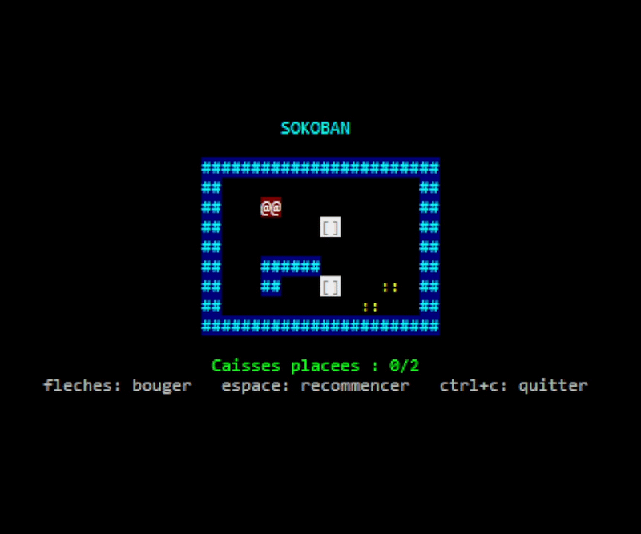

# my_sokoban

Un Sokoban en C avec la bibliothèque `ncurses`, joué directement dans le terminal, en couleurs. Pousse toutes les caisses sur les emplacements de stockage pour gagner.

## Prérequis

- `gcc` et `make`
- `ncurses` (headers de développement)
- Un système Linux ou WSL

## Installation

Sous Ubuntu / Debian (24.04 recommandé, ou WSL2 avec Ubuntu 24.04) :

```sh
sudo apt update
sudo apt install build-essential libncurses-dev
```

Puis, à la racine du projet :

```sh
make
./my_sokoban map
```

## Commandes make

| Commande | Effet |
|---|---|
| `make` | compile le jeu |
| `make clean` | supprime les fichiers temporaires |
| `make fclean` | supprime les fichiers temporaires et l'exécutable |
| `make re` | recompile tout depuis zéro |

## Commandes en jeu

| Touche | Action |
|---|---|
| Flèches | déplacer le joueur (et pousser une caisse) |
| Espace | recommencer le niveau |
| Ctrl + C | quitter |

L'écran affiche le nombre de caisses placées. On gagne quand chaque emplacement `O` contient une caisse. On ne peut que pousser une caisse, jamais la tirer : attention à ne pas la coincer dans un coin.

## Format d'une map

La map est un fichier texte rectangulaire, entouré de murs :

| Caractère | Signification |
|---|---|
| `#` | mur |
| `P` | joueur (un seul) |
| `X` | caisse |
| `O` | emplacement de stockage |
| espace | sol vide |

À l'écran, les murs sont bleus (`##`), le joueur est rouge (`@@`), les caisses sont des `[]` (vertes quand elles sont bien placées) et les emplacements sont des `::` jaunes. Utilise un terminal avec les couleurs (Windows Terminal + WSL par exemple).

Il doit y avoir autant de `X` que de `O`, et au moins un de chaque. Sinon, le programme affiche un message d'erreur sur la sortie d'erreur et quitte avec le code `84`.

Exemple (fichier `map_demo`) :

```
############
#          #
#  P       #
#     X    #
#          #
#  ###     #
#  #  X  O #
#       O  #
############
```

## Équipe

- Isore Hortense
